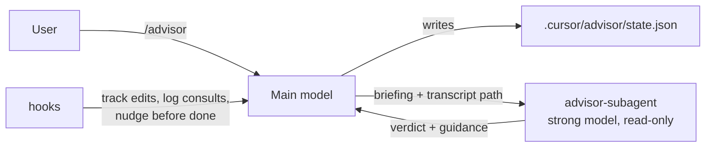

# Advisor

Advisor 為 Cursor 的 agent 提供一個更強大的第二模型，供其在關鍵時刻諮詢：在做出重大決策之前、當它卡在錯誤上時，以及當它宣告任務完成之前。主要模型繼續執行工作；advisor 會閱讀完整的簡報（若可用，也會閱讀對話記錄），深入思考，並返回包含具體指導的裁決。這讓您在複雜任務上獲得更高的品質，同時只需在關鍵處為強大模型付費。

預設的 advisor 是最新版的 Grok（Grok 4.6），且設定為最高的推理努力程度。由於 advisor 是一個擁有自己模型的 subagent，它不必是您正在對話的模型：任何可供 subagent 使用的模型都可以，因此第二意見可以來自不同的模型家族。

<a id="installation"></a>

## 安裝

```bash
/add-plugin advisor
```

<a id="quick-start"></a>

## 快速入門

```text
/advisor                     turn on with the default advisor (Grok 4.6, xhigh effort)
/advisor composer-2.5        turn on with a different model (any subagent model slug)
/advisor ask is this migration safe to run twice?
/advisor status
/advisor off
```

然後照常工作。當 agent 遇到檢查點時，它會諮詢 advisor 並用一行或兩行回報：

```text
Advisor (cursor-grok-4.6-xhigh): proceed with changes. The retry wrapper hides the real
failure; the 401 comes from a stale token cache. Dropped the retry, fixed the cache key.
```

若要讓 skill 在整個 session 中保持在上下文中，請使用 Option+Enter（macOS）或 Alt+Enter（Windows/Linux）呼叫 `/advisor`，將其作為 Custom Mode 執行。狀態檔案在兩種情況下都能運作。

<a id="how-it-works"></a>

## 運作方式



- **Skill `advisor`** 實作了 `/advisor` 命令和檢查點協議：何時諮詢、如何撰寫簡報、如何根據裁決採取行動，以及如何回報。請參閱 [skills/advisor/SKILL.md](skills/advisor/SKILL.md) 和 [briefing template](skills/advisor/references/briefing-template.md)。
- **Agent `advisor-subagent`** 是一個唯讀的 subagent，固定使用強大模型（預設為 `grok-4.6[effort=xhigh]`，可透過 `/advisor <model>` 在每個 session 中覆蓋）。它會根據儲存庫驗證簡報，在路徑可用時閱讀對話記錄，並使用 `Verdict / Why / Recommendations / Risks / Answers / Confidence` 回答。
- **Hooks** 在不增加雜訊的情況下保持模式誠實：`afterFileEdit` 記錄自上次諮詢以來檔案已變更，`subagentStop` 計算每次諮詢並將建議附加到 `.cursor/advisor/log.md`，而 `stop` 在回合結束時若存在未審查的編輯，則發布一行 `[Advisor]` 後續提示，以確保不會跳過完成前的諮詢。此提示在每批編輯中最多觸發一次，當 agent 以向您提問結束回合時保持靜默，並可透過 `/advisor nudge off` 停用。

<a id="checkpoints"></a>

## 檢查點

| 檢查點 | 觸發條件 |
| --- | --- |
| 重大決策 | 在方法之間做出選擇；遷移、刪除、公開 API 或設定變更、相依性替換、驗證或付款程式碼；模糊到足以改變工作的請求。 |
| 卡住 | 經過兩次實際嘗試後出現相同的錯誤或失敗測試；無法解釋的行為；即將新增變通方法（重試迴圈、`sleep`、廣泛的 `try/except`、跳過的測試、停用的檢查）。 |
| 宣告完成前 | 任何變更了邏輯或涉及多個檔案的任務。微不足道的編輯會被跳過並說明原因。 |
| 依請求 | `/advisor ask ...`，或詢問 advisor 的看法。 |

此 skill 將每個任務的諮詢次數限制在約四次，且從不為例行步驟或 agent 可自行驗證的事項進行諮詢。

<a id="models"></a>

## 模型

預設為最新版的 Grok 模型，且設定為最高的推理努力程度（目前為 `cursor-grok-4.6-xhigh`）。`/advisor <model>` 接受任何可供 subagent 使用的模型 slug；像 `grok fast` 或 `composer` 這樣的家族名稱會解析為該家族最新模型的最高推理層級。如果 Cursor 拒絕某個 slug，skill 會從錯誤訊息中選擇最接近的有效 slug，儲存它並通知您。團隊模型限制和方案限制適用於 advisor，如同適用於任何 subagent 一樣。

<a id="state"></a>

## 狀態

所有內容都儲存在專案根目錄的 `.cursor/advisor/` 中，隨時都可以安全刪除：

| 檔案 | 用途 |
| --- | --- |
| `state.json` | 模式、模型、提示設定、諮詢次數、繫結的對話、對話記錄路徑。 |
| `log.md` | 所有已完成的諮詢及其裁決，供後續審查。 |
| `pending` | 標記：自上次諮詢以來檔案已變更。 |
| `last-response.txt` | 最新回覆的結尾，用於避免對向您提問的內容進行提示。 |

如果您不希望它出現在儲存庫中，請將 `.cursor/advisor/` 加入您的 `.gitignore`；skill 永遠不會將其暫存。

<a id="cost"></a>

## 成本

每次諮詢是對 advisor 模型的一次呼叫，包含幾千個 token 的簡報，加上 advisor 選擇閱讀的任何內容。選擇性使用是其重點：一個典型的功能需要一到三次諮詢。預設的 advisor，Grok 4.6，從 Cursor Models 使用量池中扣除，因此是強大選項中最便宜的；當您想要不同家族的看法時，可以切換模型。

<a id="limitations"></a>

## 限制

- 狀態是每個專案獨立的，並繫結到啟用它的對話。在同一專案的第二個對話中執行 `/advisor` 會將模式重新繫結到該處（模型和提示設定會帶過；諮詢歷史和 advisor 上下文會重新開始）。使用 `/advisor status` 可以檢視而不重新繫結。
- 對話記錄路徑由 hooks 記錄，因此只有當 hooks 執行且對話記錄啟用時，advisor 才會閱讀完整的對話記錄。它總是會收到簡報。
- 回合結束時的提示依賴 plugin 的 hooks；在 hooks 不執行的地方，skill 仍會自行執行完成前的諮詢。

<a id="license"></a>

## 授權條款

MIT
