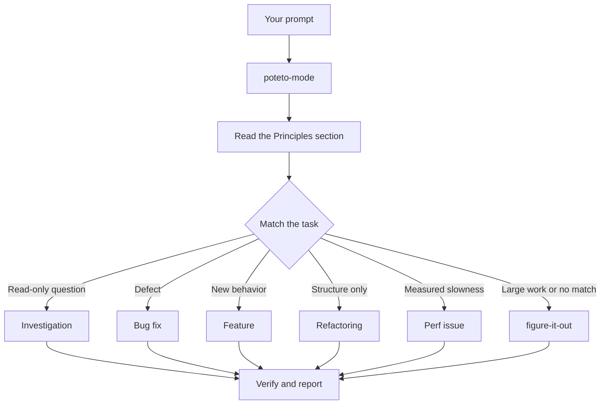

<a id="route-work-through-poteto-mode"></a>

# 透過 `/poteto-mode` 路由工作

`/poteto-mode` 是入口。你提供一個目標，它會匹配二十三個劇本之一，將該劇本的步驟複製到待辦事項清單中，並根據步驟需求呼叫其他技能。在本頁中，你將學習一個好的提示詞長什麼樣子，以及你實際需要多少提示詞。


<a id="what-happens-to-your-prompt"></a>

## 你的提示詞會發生什麼事



圖示顯示了常見的路由。還有其他劇本，用於提升指標、診斷執行期症狀與擷取的追蹤記錄、原型、視覺一致性、撰寫與評估技能、自主執行、開啟 PR、監控 PR 或堆疊直至可合併狀態、發布已驗證的堆疊、自動執行 PR 佇列或堆疊、協調專案規模的程式、會話接續、安全暫停、多階段計畫，以及 worktree 清理。[playbook 目錄](../../skills/poteto-mode/playbooks/) 包含完整的劇本集合。

<a id="say-the-goal-not-the-ceremony"></a>

## 說明目標，而非儀式

你不需要撰寫規格說明。你只需說明哪裡出錯或你想要什麼，加上任何你已經知道、能為 agent 節省時間的資訊：

```text
/poteto-mode users get two notifications after a retry. repro first, then fix and verify.
```

這是一個 Bug 修復提示詞。「先重現」是一個實際的約束條件，而非禮貌用語，劇本會遵守它。觀察待辦事項清單填入 Bug 修復步驟。被跳過的步驟會以 `skip: <reason>` 保持可見。

<a id="what-goes-in-a-prompt"></a>

## 提示詞中應包含什麼

一個有用的提示詞最多包含五項內容，每一項都可以用一句話表達：

- **目標。** 說明哪裡出錯，或你想要什麼。
- **完成檢查。** 它必須能透過或失敗。「讓它更好」和「花一個小時處理它」不是檢查。
- **你想看到的證明。** 要求真實的指令輸出、流程影片、儲存的值，或前後對比數字。
- **你已經知道的。** 症狀、重現步驟、紀錄行或連結可以為 agent 節省搜尋時間。
- **實際的約束條件。** 「先重現」、「先不要更改任何程式碼」、「零行為變更」和「讓我審查後再繼續」都會改變 agent 的執行方式。

這裡是一個包含所有五項的提示詞：

```text
/poteto-mode the csv export drops its last row since yesterday's deploy. failing job id is 4812. repro first, then fix. done means the 60k-row fixture exports every row. show me the row counts before and after.
```

有兩件事值得省略：

- **方法。** 說明要達成什麼，並留給 agent 空間去尋找比你所選更好的路徑。技能清單也是如此，詳見下方的陷阱。
- **你最初對原因的理論。** 明確提出的猜測會將搜尋範圍縮小到你所指的方向。在分享你的直覺之前，先讓 agent 重新陳述問題。

對於雜訊較多的報告，例如長串對話或模糊的 Bug，將重述設為第一步：

```text
/poteto-mode read this thread. restate the underlying issue in your own words, in plain english. don't change any code yet.
```

誤讀會在重述中顯現，早於任何程式碼存在。在那裡糾正它，你只需花一條訊息，而不是一個錯誤的修復。僅針對重述，不使用劇本，執行 [`/in-your-own-words`](../../skills/in-your-own-words/SKILL.md)。它會重述 agent 認為你的目標是什麼，以及你試圖解決的問題。

當你不確定提示詞是否瞄準正確時，在傳送前對其執行 [`/sharpen`](../../skills/sharpen/SKILL.md)：

```text
/sharpen write a migration guide for the v2 config format.
```

Agent 會說明頂尖專業人士會做但你沒要求的事、他們會從最原始的素材開始、他們會使用的方法和工具，以及除了你或 agent 之外，誰能證明結果是正確的。然後它會重寫你的提示詞，要求恰好這些內容，更深但不更大，並保留你的選擇空間。它不會執行任務。閱讀重寫後的內容，然後傳送它，例如使用 `/poteto-mode`。

<a id="follow-up-short"></a>

## 簡短地跟進

當對話已經包含上下文時，提示詞會縮小到幾乎沒有。以下這些都足夠：

```text
/poteto-mode do it
```

```text
continue
```

```text
keep going until done
```

簡短有效，因為劇本持有結構，而 Custom Mode 在每一輪都讓 `/poteto-mode` 保持在上下文中。[設定 pstack](./01-setup.md#run-your-first-task) 顯示如何開始一個。你的話傳達意圖，而技能傳達嚴謹性。

<a id="switch-tasks-with-new-task"></a>

## 使用「新任務」切換任務

長對話會累積來自上一個任務的上下文。當你改變主題時，請說明：

```text
/poteto-mode new task. figure out why the cache entry survives logout. don't change any code yet.
```

「新任務」告訴 `/poteto-mode` 重新匹配，而不是繼續先前的劇本。「先不要更改任何程式碼」將此任務鎖定在調查模式。沒有這兩個短語，處於功能開發中途的模式傾向於將你的問題視為下一個功能步驟。

<a id="give-parallel-work-its-own-machine"></a>

## 為並行工作提供獨立的機器

如果你在同一臺電腦上對同一個儲存庫執行多個 agent，它們會爭奪工作樹、埠和建置輸出。最乾淨的隔離方式是 [cloud subagent](https://cursor.com/docs/subagents#cloud-subagents)。每個 agent 都有自己的 VM 和分支，因此它可以安裝依賴項、執行你的應用程式，並記錄結果的影片，而不影響你的機器。在任務前輸入 `/in-cloud`，或要求父對話將工作交給 cloud subagents。

當工作必須留在本地時，請提前要求建立 worktree：

```text
/poteto-mode new task. branch off <base> in a fresh worktree, then port the parser change there.
```

每個任務在獨立的分支和 worktree 中，意味著沒有 agent 會覆蓋另一個的檔案。Worktrees 消耗磁碟和機器資源，因此筆記型電腦一次只能執行少數幾個。[開啟 PR 劇本](../../skills/poteto-mode/playbooks/opening-a-pr.md) 已經從 worktree 開始處理程式碼變更，因此通常只有當特定的基底或位置重要時，你才需要這樣說。

Worktrees 會累積。當磁碟空間緊張時，請要求：

```text
/poteto-mode what's eating my disk? prune the worktrees that are safe to prune.
```

[Worktree 清理劇本](../../skills/poteto-mode/playbooks/worktree-cleanup.md) 根據合併狀態、未提交的變更，以及哪些對話仍在接觸它來對每個 worktree 進行分類。它只刪除證據明確允許刪除的內容，並對任何持有未提交變更的內容暫停等待你的決定。

<a id="leave-it-running"></a>

## 讓它繼續執行

當你離開時，說明完成意味著什麼，然後離開：

```text
/poteto-mode im stepping away. keep going until the migration check reports zero old callers. log your decisions.
```

你稍後會審查的工作會透過 [`/figure-it-out`](../../skills/figure-it-out/SKILL.md) 路由，它設計執行的階段並維護 [`/show-me-your-work`](../../skills/show-me-your-work/SKILL.md) 決策紀錄。[在你睡覺時執行工作](./07-overnight.md) 涵蓋完整的過夜合約。

**陷阱：** 不要在提示詞中列舉技能（「使用 /how，然後 /architect，然後 /arena...」）。劇本已經對它們進行了排序，而手寫的順序通常會重新排序或遺漏劇本會保留的步驟。只有當你想覆蓋特定選擇時，才命名一個技能。

閱讀 [`poteto-mode`](../../skills/poteto-mode/SKILL.md) 本身以瞭解完整的路由規則。

下一步：[理解程式碼](./03-understand.md)。
