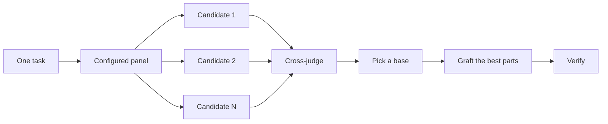

<a id="design-before-you-write-code"></a>

# 在撰寫程式碼之前先進行設計

對困難設計只嘗試一次，就會鎖定模型最初想到的形狀。`/architect` 在實作之前先確定型別與邊界。`/arena` 對同一份需求進行多次嘗試，並合併最佳的部分。`/interrogate` 讓其他模型嘗試破壞結果。當工作重點在於覆蓋率而非設計綜合時，`/swarm` 會分散切片或競賽，並彙總其結果。

兩種最常見的設計錯誤是：直接採用 agent 的第一個設計，以及打磨一份未經程式碼測試的計畫。本頁修正這兩個問題。您透過程式碼進行規劃。原型回答未決問題，README 或教學設定目標，而書面計畫最後才出現。


<a id="settle-the-shape-with-architect"></a>

## 使用 `/architect` 確定形狀

```text
/architect design the import pipeline before writing any code. i care most about how callers use it.
```

[`/architect`](../../skills/architect/SKILL.md) 首先建立基礎，對設計涉及的程式碼執行 `/how`，當涉及所有權或層級變動時執行 `/why`。接著它執行 `/arena` 以產生競爭性的設計草圖，每份草圖先撰寫呼叫者的使用方式，接著是型別、簽名，以及模組地圖。

預設情況下，它會直接從綜合設計進入實作。如果您想先檢視設計，請明確說明：

```text
/architect with checkpoint. stop and show me before implementing.
```

一旦程式碼開始，設計就不再是神聖不可侵犯的。如果實作顯示在不相關的地方出現相同的變通方法，或者型別只能透過 `any` 或強制轉型才能編譯，`/architect` 會將此視為設計錯誤的證據。它會丟棄草圖並重新開始，而不是在周圍打補丁。

<a id="fan-out-attempts-with-arena"></a>

## 使用 `/arena` 分散嘗試

```text
/arena take my prompt to the arena verbatim. i want to compare their proposals with yours.
```

[`/arena`](../../skills/arena/SKILL.md) 是底層的通用工具。N 個 subagent 並行嘗試相同的設計或程式碼需求，每個都寫入自己的 worktree 或目錄。一個唯讀評審者（如果您的設定允許，使用不同的模型家族）根據評分標準對每個候選方案進行評分。協調者從頭到尾閱讀每個候選方案，選擇一個基礎，嫁接來自落選者的最佳想法，並驗證結果。



評審小組來自您的 [`/setup-pstack`](../../skills/setup-pstack/SKILL.md) 設定，您可以針對每個任務進行調整。當決策重要時要求更多候選方案，不重要時則要求較少：

```text
/arena this, 5 candidates. the cache key format is expensive to change later.
```

<a id="cover-slices-and-races-with-swarm"></a>

## 使用 `/swarm` 覆蓋切片與競賽

```text
/swarm check every package under packages/ against its check.sh. one worker per package. one report.
```

[`/swarm`](../../skills/swarm/SKILL.md) 將 N 個工作者分散到獨立的切片、覆蓋率矩陣、關卡通道、探索分割槽，或已宣告的競賽分支。每個工作者獲得自己的範圍與檢查，然後回報 `PASS`、`ISSUES` 或 `BLOCKED`。父程序等待工作者完成，並回傳一份包含任何缺口或中斷的簡潔報告。

當並行效能帶來覆蓋率或讓獨立檢查進行競賽時，請使用它。`/arena` 給每個工作者相同的設計或程式碼需求，然後選擇一個基礎並嫁接最佳部分。`/swarm` 覆蓋切片或執行具有預先宣告選擇規則的競賽。它不使用基礎選擇與嫁接儀式。

<a id="break-it-with-interrogate"></a>

## 使用 `/interrogate` 破壞它

```text
/interrogate the whole branch, but skeptically. no nitpicks unless it's an actual bug or regression.
```

[`/interrogate`](../../skills/interrogate/SKILL.md) 將相同的 diff、意圖和評分標準傳送給不同模型家族的評審者。模型多樣性是重點。不同模型有不同的盲點，因此兩個模型獨立提出的發現是高置信度訊號。主導者將所有內容分類為 `Act on`、`Consider`、`Noted` 和 `Dismissed`，每個駁回都有理由，並且不會自動套用任何內容。

也要閱讀駁回的內容。主導者是一位務實的資深工程師，而非神諭，您可以推翻其決定。

<a id="prototype-instead-of-debating"></a>

## 用原型代替辯論

永遠不要採用第一個設計。要求幾個，並從您可以看到的證據中選擇：

```text
/poteto-mode prototype a few options for the new dropdown menu. take screenshots or videos for me to compare.
```

[Prototype playbook](../../skills/poteto-mode/playbooks/prototype.md) 在暫存目錄中建立一次性草圖，將變體放在一個切換器後面，驅動每一個，並擷取螢幕截圖或計時。它也適用於行為和演演算法，不僅限於 UI。原型是用程式碼進行規劃。它們讓 agent 透過執行某些內容來回答自己的未決問題，而不是詢問您，並為您可能沒想到的選項留出空間。

相同的想法可以擴充套件到實際設計。將 `/architect` 與原型配對，並保留一個審查閘門：

```text
/poteto-mode we need rate limiting for external webhooks. /architect it first, and answer open questions with prototypes. let me review before proceeding.
```

不要在抽象計畫上浪費評審者。`/interrogate` 屬於 diff。將對抗性審查指向沒有程式碼背後的計畫，評審者會發明理論上的風險和永遠不會發生的邊緣情況。讓原型解決問題，然後審查已建構的內容。

<a id="write-the-readme-first-for-shared-code"></a>

## 為共用程式碼先撰寫 README

對於其他程式碼將使用的套件或 API，從使用者會閱讀的檔案開始：

```text
/poteto-mode write a tutorial for how i would use the new config package first. then /teach me why it beats the current one.
```

先撰寫教學會強制採用呼叫者的視角。您向假設的使用者描述 API，並回溯到實作。檔案也成為一個具體目標，agent 會據此檢查自己的工作。當檔案本身很重要時，指名 [`/technical-writing`](../../skills/technical-writing/SKILL.md)，以便教學保持為教學，而不是同時偏離為參考和說明。

<a id="plan-after-the-design-settles"></a>

## 在設計確定後再規劃

pstack 故意沒有規劃 skill。當您確實想要一份書面計畫時，請在設計確定後要求它：

```text
/poteto-mode turn this design into a plan. small verifiable PRs, each with its own verification steps.
```

[Multi-phase plan playbook](../../skills/poteto-mode/playbooks/multi-phase-plan.md) 透過原型解決任何剩餘的未決問題，然後為每個 PR 撰寫一個章節，每個章節以證明變更有效的證據結尾。僅透過的測試套件不算作該證據。計畫是交付物。playbook 不會實作它，並指名接下來應該執行哪個執行 playbook。

對於遷移，在提示中說明標準：

```text
/poteto-mode plan the migration of our ui library to the new styling system. small verifiable PRs, each with visual regression checks. the result must match the original exactly, bugs included.
```

"包含 bug" 可防止遷移在過程中悄悄修復問題，這將使舊和新輸出無法比較。對於跨越多天的專案，您可以暫時將計畫提交到儲存庫，以便其他 agent 看到進行中的工作。當工作完成時刪除它。

<a id="how-much-design-work-does-a-task-deserve"></a>

## 任務值得多少設計工作？

您可能在想知道每個變更是否需要這些。不需要。大多數變更不需要任何這些。一個粗略的階梯：

- 一個小型、已完成但您不確定的變更只需要 `/interrogate`。
- 跨越函式邊界或移動所有權的變更值得 `/architect`，這會帶來 `/arena`。
- 一個獨立決策，其中獨立嘗試會有幫助，例如命名、格式或演演算法，直接是 `/arena`。
- 覆蓋率矩陣、一組並行檢查，或具有已宣告分支的競賽是 `/swarm`。
- 一個可以透過執行某些內容來回答的未決問題，例如佈局、計時或方法，需要一個原型，而不是辯論。
- 一個有爭議且難以逆轉的設計需要 `/architect`，然後在發布前進行 `/interrogate`。
- 跨越多個 PR 的工作需要一份計畫，在設計確定後撰寫。

`/poteto-mode` 已套用此階梯。跨越邊界的工作會自動觸發 `/architect`，因此您直接採用這些選項，主要是為了獲得比預設值更多或更少的審查。

下一步：[建置並清理變更](./05-build-and-clean.md)。
