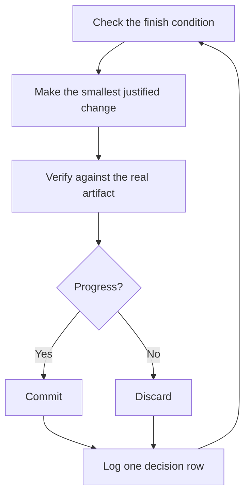

<a id="run-work-while-you-sleep"></a>

# 在你睡覺時執行工作

這是之前所有努力的回報。一個你可以信任它來驗證自身工作的 agent，就是一個你可以放心交給它處理艱鉅任務的 agent。讓這件事變得安全的不是希望，而是一個可檢查的完成條件、一個隔離的 worktree 或雲端 agent，以及一份你早上可以稽核的決策記錄。


<a id="earn-the-trust-before-the-loop"></a>

## 在進入迴圈之前先贏得信任

一個你不信任的迴圈只會更快地產出未經檢查的工作，而且混亂會隨著每次迭代而累積。在你讓它獨自執行之前，請確認它已經贏得了信任：

- 你已經手動完成過一次該任務，或看過 agent 執行過，因此你知道什麼樣的工作是合格的。
- 該 agent 擁有你自己會使用的工具和訊號：驗證 skill、profiler、紀錄。
- 每個階段都證明其工作成果，並能在工作未達標時停止流程。
- 你已經閱讀了幾份對話記錄，並將重複發生的失敗轉化為工具、skill 或檢查機制。

只有當以上四點全部成立時，才讓迴圈自主執行。在那之前，請在你監視下執行它。

<a id="the-overnight-contract"></a>

## 過夜合約

一個良好的交接包含目標、完成條件、許可權和逃生機制。它不需要很長：

```text
/poteto-mode im going to bed. migrate every caller to the new parser in a fresh worktree off <base>.
done means zero old callers, all parser fixtures pass, old api deleted.
keep a decision log. don't ask me before committing.
/loop until done. if you're truly stuck after a few hours, stop and write up why.
```

逐行說明每一行為你帶來什麼：

- "im going to bed" 是一個 session 覆蓋指令。agent 會停止詢問並繼續執行。
- "done means..." 將目標轉化為每次迭代都可以執行的檢查。
- "fresh worktree off `<base>`" 確保此次執行不會與你開啟的其他任何內容發生衝突。
- "don't ask me before committing" 預先回答了 agent 否則會卡住的許可權問題。
- `/loop` 是 Cursor 內建的喚醒機制，而非 pstack skill。[Autonomous run playbook](../../skills/poteto-mode/playbooks/autonomous-run.md) 使用它來在事件或心跳時重新檢查完成條件。
- 逃生機制讓它在遇到真正的死衚衕時停止並記錄原因，這比花八小時進行創意性的目標重新解讀要好得多。

因為你會在離開後審查這些工作，`/poteto-mode` 會將其路由至 [`/figure-it-out`](../../skills/figure-it-out/SKILL.md)，該機制會在任何程式碼之前設計執行階段，並接入決策記錄。

若要故意停止執行，請告訴 agent 暫停，或告訴它你即將離線或重新啟動 Cursor。[Pause safely playbook](../../skills/poteto-mode/playbooks/pause-safely.md) 會完成或回退當前步驟，提交一個進行中的檢查點，並撰寫一份恢復筆記。新的聊天會透過 Session pickup playbook 從該筆記繼續工作。說 "keep going" 永遠不會觸發暫停。

<a id="what-the-loop-does-all-night"></a>

## 迴圈整晚在做什麼



每次迭代進行一項變更、一項檢查、記錄一行紀錄。沒有幫助的變更會被丟棄，而不是留著不管。遇到瓶頸意味著轉向，而非停止，且完成條件絕不會悄悄放寬以宣告勝利。

<a id="the-morning-audit"></a>

## 早晨稽核

[`/show-me-your-work`](../../skills/show-me-your-work/SKILL.md) 讓執行變得可審查。每一行記錄時間、階段、決策、原因、證據指標和結果，儲存為位於 `decisions.tsv` 的 TSV 檔案（當多個執行共用同一目錄時，則為 `.audit/<task-slug>.tsv`）。預設情況下它保持在本機。當工作足夠宏大，審查者需要追蹤記錄來信任結果時，再提交它。

當你回來時，請以審查形式要求檢視執行結果：

```text
/show-me-your-work catch me up on what you did last night
```

在 skill 返回摘要之前，它會生成一個使用不同模型家族的 reviewer 來閱讀追蹤記錄和對話記錄，回覆末尾會包含一個 Attention 部分，列出值得你審視的內容。先閱讀該部分，然後閱讀它指向的紀錄行。你是在稽核決策，而不是重新閱讀整晚的內容。

若要快速檢視狀態而非進行稽核，請在執行該工作的聊天中執行 [`/ketchup`](../../skills/ketchup/SKILL.md)。它只讀取，並用簡潔的語言告訴你自你上一則訊息以來發生了什麼變化，附上工作產生的截圖和小型圖表。然後它會列出每個等待你處理的呼叫，例如合併、核准或在選項之間做選擇，並附上其建議、證據和風險，讓你僅憑回覆即可做出決定。

<a id="when-the-night-holds-a-queue-not-a-task"></a>

## 當夜晚包含一個佇列而非單一任務時

上述合約驅動單一任務達到單一完成條件。有些夜晚包含更多內容，例如一個獨立變更的佇列或整個程式。三個 playbook 將相同的信任擴充套件到更大規模。

[Autopilot-full](../../skills/poteto-mode/playbooks/autopilot-full.md) 執行一個獨立 PR 的佇列直至合併。每個 PR 由一個 owner agent 負責，從建置到合併全程跟進，且 owner 不會根據自己的判斷進行合併。一群新的 verifier 會檢查 owner 的 code-ready head。後續的 rebase 或小幅修復只需一個新的 verifier，只有新行為或大型新 diff 才會再次呼叫完整的 verifier 群組。只有對待合併 patch 的乾淨判斷才能授權合併：

```text
/poteto-mode full autopilot on this queue. each item is independent. i want them merged by morning.
```

[Autopilot-stack](../../skills/poteto-mode/playbooks/autopilot-stack.md) 執行相同的 owner 迴圈，但不發布任何內容。你醒來時會看到一個線性的 base-branch 堆疊，每個連結都有 verifier 的判斷，由你自己審查並落地。當變更相互耦合，或在你希望任何合併前親眼檢查工作時，請選擇 Autopilot-stack 而非 Autopilot-full：

```text
/poteto-mode autopilot these five changes but stack them, don't ship. i'll land the stack in the morning.
```

[Orchestrate](../../skills/poteto-mode/playbooks/orchestrate.md) 適用於超越單一 agent 生命週期的程式：跨越多天、多個堆疊的 PR、在一個常駐協調聊天下的 subagent 群組。協調者撰寫簡報、收集 subagent 完成的內容、保持最低未合併 PR 為綠色，且從不自己撰寫程式碼。這是刻意設計的重型機械。如果一個 agent 能在一個 session 內完成工作，該 playbook 本身會將你導回上述的過夜合約：

```text
/poteto-mode orchestrate the store migration. own it until every package is converted and merged. i'll check in twice a day.
```

<a id="run-many-projects-in-parallel"></a>

## 並行執行多個專案

[Cursor Project](https://cursor.com/blog/projects) 為一個協調 agent 提供持久執行緒。協調者不撰寫程式碼。它指揮 subagent，這些 subagent 預設在雲端執行，因此即使你的筆記型電腦關閉，工作也會繼續。這是 Orchestrate playbook 預期的形態。以 `/poteto-mode` 開始你對協調者的提示，它生成的 subagent 將遵循 playbook。

幾個習慣有助於此：

- 為每項工作分配獨立的 Project，例如一個功能、一次遷移、一次效能提升或技術債清理。多個專案可以並行執行。
- 將相關的聊天拖入 Project，包括已完成的。它們會成為其中每個 agent 的上下文。
- 在每個 PR 合併前提供一個驗證群組，並讓 Autopilot-stack 或 Autopilot-full 處理佇列。
- 要求協調者提供有資料支援的計畫，並讓它在詢問你之前先用原型回答未決問題。

一個提示可以承載整個 Project，從研究到執行：

```text
/poteto-mode refactor this repo so its architecture is more agent friendly. use /correct and /architect on past commits and review comments to find the mistakes agents make most here. use /recall for context from past chats. answer open questions with prototypes instead of asking me. come back with a plan backed by real data. once i approve it, run it with autopilot-stack or autopilot-full, and ask me which.
```

<a id="let-loops-start-themselves"></a>

## 讓迴圈自行啟動

上述每個迴圈仍需等待你啟動。排程或事件驅動的自動化移除了這一步。軟體維護可分為適合此模式的階段：分診報告、重現問題、修復問題、驗證修復。兩條規則讓這樣的流程保持可信：

- 每個階段都可以停止流程。分診可以判定報告描述的是預期行為，重現可能無法重現問題，而修復者可能判定變更風險過高。這些結果都有用處，因為它們能防止不良工作進入下一個階段，而在下一個階段撤銷的代價會更高。
- 每個階段都會移交證據。重現會附上損壞狀態的螢幕截圖和影片，而修復則附上修復前後的證明。這樣，人類可以在閱讀任何一行程式碼之前，先檢查 agent 是否修復了正確的問題。

pstack 將此作為一個休眠的 [automation pack](../../automations/benny/README.md)，用於 Slack 問題報告。一個自動化流程會對每個報告進行分診。另一個自動化流程會重現已確認的錯誤，並可能準備一個小型的修復草稿。將 agent 指向其 [`FOR_AGENTS.md`](../../automations/benny/FOR_AGENTS.md) 並指定目標儲存庫，即可完成設定。

**陷阱：** 持續時間並非完成條件。「花 4 小時處理這件事」無法讓 agent 檢查任何標準，你醒來時只會看到四小時的動作，而非結果。請為 `/loop` 提供一個可以透過或失敗的判定條件。

下一步：[以原則名稱進行引導](./08-principles.md)。
