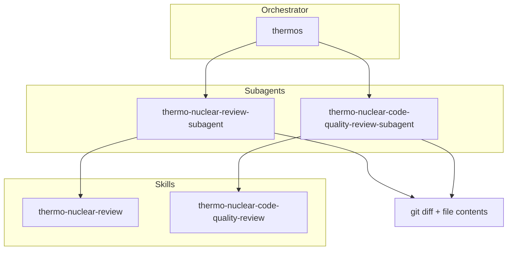

<a id="thermos-plugin"></a>

# Thermos 外掛

Thermos 分支審查，適用於 Cursor 代理：深度正確性與安全性稽核、嚴苛的可維護性評量標準，以及平行子代理協調。

<a id="installation"></a>

## 安裝

```bash
/add-plugin thermos
```

<a id="architecture"></a>

## 架構



<a id="skills"></a>

## 技能

| 技能 | 描述 |
|:------|:------------|
| `thermo-nuclear-review` | 深度分支稽核（錯誤、破壞、安全性、開發體驗、功能閘門漏洞）。 |
| `thermo-nuclear-code-quality-review` | 嚴格的可維護性稽核（程式碼柔術、千行規則、混亂結構、邊界）。 |
| `thermos` | 平行執行兩個審查子代理並整合結果。 |

<a id="agents"></a>

## 代理

| 代理 | 描述 |
|:------|:------------|
| `thermo-nuclear-review-subagent` | 深度審查評量標準的任務子代理（差異範圍）。 |
| `thermo-nuclear-code-quality-review-subagent` | 程式碼品質評量標準的任務子代理（差異範圍）。 |

<a id="typical-usage"></a>

## 典型用法

**雙重審查（thermos）：**

1. 收集 `git diff main...HEAD` 以及變更檔案的完整內容。
2. 在單一訊息中呼叫兩個子代理，並使用 `run_in_background: true`。
3. 整合優先排序且去除重複的結果。

**單一技能：** 在主代理中呼叫 `thermo-nuclear-review` 或 `thermo-nuclear-code-quality-review`，或在收集差異上下文後呼叫對應的子代理。

<a id="migration-from-cursor-team-kit"></a>

## 從 cursor-team-kit 遷移

`cursor-team-kit` 先前僅包含 `thermo-nuclear-code-quality-review`。該技能與代理現在位於 **Thermos**，與深度審查及 `thermos` 一同。安裝此外掛時，請從 team-kit 移除舊的 thermo 專案以避免重複。

<a id="license"></a>

## 授權

MIT
